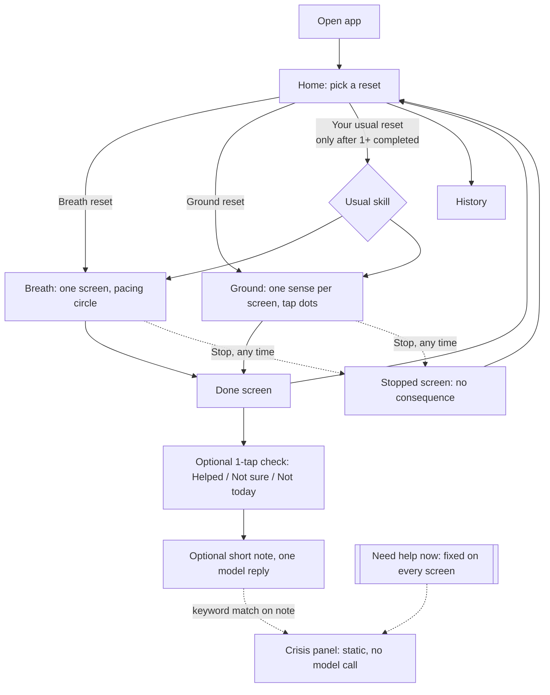

# Reset: Design Notes (Part 3.1)

> Coursework skills prototype. Not a mental health support tool, not therapy, and nobody monitors what is entered. Tested only with fictional scenarios.

## 1. Concept

**Reset** offers two short skills, framed the way athletes use a quick reset between plays or after a hard drill:

- **Breath reset**: paced breathing, inhale 4 / exhale 6.
- **Ground reset**: 5-4-3-2-1 sensory grounding, answered with taps instead of typing.

The sports idea comes from my own interests. I use it as framing only: the names, a few calm words ("reset", "timeout"), and the fictional test personas. It does not change the skill steps.

### Where the sports framing could go wrong

Sports language can easily turn into coach talk ("Let's go!", "Crush it!", "New personal best!"). D6 says cheerful phrasing felt condescending to participants. D3 lists *being asked to perform* as an emotional cost. So the app deliberately has:

- no scores, streaks, badges, or "personal bests"
- no motivational or hype phrasing
- no performance language for stopping early ("quit", "fail", "incomplete")

The sports part is the *idea of a reset*: short, normal, done before getting back to what you were doing. It is not about competition. An open question (section 10) is whether this framing works for people who don't care about sports.

## 2. Main flow



The **Need help now** button sits in the same spot on every screen, including inside an exercise and when the model has failed. It opens a panel that is plain static content in the frontend and makes no network request.

## 3. Screen sketches

```
HOME                              BREATH RESET (inside exercise)
+------------------------------+  +------------------------------+
| Reset          [Need help now]|  |                [Need help now]|
|                              |  |                              |
|  Take a short reset.         |  |            .---.             |
|  Stop whenever you want.     |  |          (       )           |
|                              |  |            '---'             |
|  [ Breath reset   ~1 min  ]  |  |        Breathe in... 3       |
|  [ Ground reset   ~1 min  ]  |  |                              |
|  [ Your usual: Breath     ]  |  |                              |
|                              |  |          [ Stop ]            |
|  History                     |  |                              |
+------------------------------+  +------------------------------+

GROUND RESET (one sense per screen) DONE
+------------------------------+  +------------------------------+
|                [Need help now]|  |                [Need help now]|
|  Notice 4 things you can feel|  |  That's the reset.           |
|                              |  |  <one short model line>      |
|     ( * ) ( * ) ( ) ( )      |  |                              |
|   tap a dot each time you    |  |  How was it? (optional)      |
|   notice one, no need to     |  |  [Helped][Not sure][Not today]|
|   type what it is            |  |                              |
|                              |  |  [ Back to home ]            |
|   [ Next sense ]   [ Stop ]  |  |                              |
+------------------------------+  +------------------------------+
```

The home screen is the "biggest" the app ever gets: two or three choices plus History. Inside an exercise there is only the cue, Stop, and Need help now.

## 4. Decisions and the findings behind them

| Decision | Findings | Trade-off / what I give up |
|---|---|---|
| Two skills only: breathing and grounding | D3 (emotional cost is concentrated on breathing and grounding, and both can be done with almost no input), R1 | No STOP or reframe. The reframe asks for thinking and typing that conflict with D3 and the 90 s limit. |
| One action per screen; grounding shows one sense at a time | D2 | Grounding takes 5 screens instead of 1 list, which means more transitions to time. |
| Taps instead of typing in grounding | D3 | The app does not know *what* the user noticed, so the model cannot respond to it. That is intentional. |
| Stop button on every exercise screen. Stopping goes to a neutral screen ("You stopped. That's fine.") and is recorded as "stopped", never as a failure | R3 | Stopped sessions still count in history, but they are worded neutrally. |
| User picks the skill. "Your usual" is an extra choice, never an automatic redirect | R4, D5 | Takes one more tap than auto-starting the usual skill, but the user keeps control. |
| Need help now is fixed on every screen, static, and works offline from the model | R2, D4 | Takes a little screen space everywhere, including inside exercises. |
| Interface contraction is tied to *where the user is*, not to detected distress | D1 | The app never claims to know how someone feels. Contraction is by design: home > exercise > done. |
| Muted colors, slow motion only in the breathing cue, short plain sentences | D6 | Less "branded" look. The sports theme stays in words, not bright visuals. |
| Model writes only short lines; the steps are hard-coded | D6, assignment §2 | Less "chatty" app, but the model cannot change or invent the skill. |

## 5. D1 without a distress detector

The study says the interface should contain less as distress rises, but it does not say how a system would know. My app **does not try to detect distress**. I considered three options:

1. **Infer it from clicks or speed** (idea from the in-class discussion of the clicking-behavior study). Rejected for now: it could be wrong often, it could feel like the app is watching (the assignment says it must not imply monitoring), and it takes a decision away from the user (R4).
2. **Ask with a one-tap check-in** ("How are you right now?"). Rejected for now: it asks the user to rate their feelings, which is an emotional cost (D3).
3. **Contract by location.** Chosen. Each step deeper into the experience has less on screen. The user decides how deep to go by choosing to start.

What the app actually knows: which button was tapped, timing, whether the user stopped, the optional 1-tap check, and optional note text. What it assumes: someone who starts an exercise wants fewer things on screen. How the user can correct it: Stop or go back home at any time.

## 6. Role of the model and its limits

Model: Claude through the Anthropic API (planned: `claude-haiku-5-5`, set by an environment variable so it can change). The backend calls the model, never the browser.

**What the model does**
- One short opening line before an exercise (max ~20 words).
- One short closing line on the Done screen, adjusted to light context: which skill, whether it was the user's usual, how many times they've done it.
- One short reply if the user writes an optional note after a reset.

**What the application controls (not the prompt)**
- The skill steps and their text, stored in a fixed script table and never generated.
- Timing of the breathing cue.
- Stop / exit buttons and where they go.
- The Need help now panel and its content.
- What gets saved.

**Limits in the system prompt** (a second layer, not the main safety mechanism):
- No diagnosis, no clinical terms, no therapeutic advice, no new techniques.
- No hype or cheerful coach language, no exclamation marks, no emojis.
- Max 2 sentences.
- Do not say or imply anyone is watching or will follow up.
- Do not claim to be a therapist.

**Output check in code:** if a reply is too long, or contains blocked words from a short list (e.g., "diagnose", "disorder", "you should try"), it gets replaced with a fallback line.

**Failure handling:** model calls time out after ~3 s. On timeout or error the app shows a fixed fallback line (e.g., "That's the reset. Take your time.") and keeps working. The opening line is requested while the home screen loads, so it does not add time inside the exercise.

This is similar to the hotel chatbot: retrieved, fixed information (there, hotel data; here, the skill script and the user's own history) goes into the context, and the model only phrases things around it.

## 7. Crisis access and crisis-related input

**Independent route (always available):** "Need help now" button in the header on every screen. It opens a static panel that is part of the frontend bundle:
- Call or text **988** (Suicide & Crisis Lifeline, US)
- Text **HOME to 741741** (Crisis Text Line)
- Call **911** for an emergency
- One line: "This is a class prototype. It can't help in an emergency."

No API call, no model, no classifier is involved. It must work with the backend stopped. That is one of my planned behavior checks.

**Crisis-related input (documented decision):** the only free text is the optional note after a reset. Before that text is sent to the model, a keyword/phrase list in the backend (also mirrored in the frontend) checks it.
- If it matches, the model is **not called**. The app shows a fixed, calm message and opens the crisis panel. The user can close the panel and keep using the app; nothing is locked.
- The message is saved with `crisis_flag = 1` so I can test it. It is not sent anywhere.

**Limits of the keyword list:**
- It misses indirect or misspelled language.
- It has false positives, which matters with sports framing: "this drill is killing me" or "I'm dead after practice". A false positive only opens an info panel, which costs little, so I accept more false positives than misses.
- It is never presented as detection or monitoring.

## 8. Timing (R1, assignment §5)

Measured from the first exercise instruction to the final planned step. Entry and the Done screen are reported separately.

**Breath reset**
- First instruction ("Follow the circle. In for 4, out for 6."): 3 s
- 6 cycles × (4 s in + 6 s out) = 60 s
- Final step ("Last breath out. That's it."): 3 s
- **Total ≈ 66 s.** No model call happens inside the sequence, so no network delay is added.

**Ground reset** (assumes ~2.5 s to notice each item and tap)
- Intro instruction: 3 s
- 15 items × 2.5 s = 37.5 s
- 5 sense screens × ~3 s to read the prompt = 15 s
- **Total ≈ 56 s.** At a slower 4 s per item: 3 + 60 + 15 = 78 s, still under 90.
- The user can tap "Next sense" early. Nothing forces them to find all items.

**Entry** (home > tap a reset): ~3–5 s, reported separately.

No timer ends the exercise or kicks the user out. If someone takes longer, the exercise waits.

Small experiment for 3.2: build the breathing cue alone and log real timestamps from first instruction to final step to compare against 66 s.

## 9. Data stored (SQLite) and personalization

Single local user, no accounts, nothing leaves localhost except model requests.

```
sessions
  id, started_at, ended_at, skill ('breath'|'ground'),
  status ('completed'|'stopped'), steps_completed, duration_s,
  feedback ('helped'|'not_sure'|'not_today'|NULL), was_usual (0/1)

messages
  id, session_id, role ('assistant'|'user'), content,
  source ('model'|'fallback'|'static'), crisis_flag (0/1), created_at

skill_steps          -- fixed script, seeded, never written by the model
  skill, step_order, text, duration_s
```

**Personalization (D5) without setup:**
- "Your usual" = the skill with the most completed sessions in the last 10. It only appears after at least one completed reset.
- If the user said "Not today" the last two times for a skill, it is not shown as "usual". (Open question: is that too clever?)
- The model's closing line can mention context lightly, e.g. "Your usual breath reset, done."

**What the user sees (History):** a simple list with date, skill, "Done" or "Stopped", and about how long. No streaks, charts, or scores. One "Clear history" button deletes everything.

**What I give up:** no settings screen, so a user can't, for example, set breathing to 5 cycles. Adding settings would be configuration burden (D5). This could be revisited.

## 10. Questions still open

1. Does the sports "reset" framing help, or does it push some users away? Test it with a non-sports fictional persona too.
2. Is a 66 s breathing exercise the right length, or should there be a shorter ~40 s option? (R1 says ~60 s felt comfortable.)
3. Should the breathing cue include optional sound or vibration? Speech is optional in the assignment and adds browser testing.
4. Is the "Not today hides the usual" rule helpful, or does it take control away?
5. How large should the crisis keyword list be, and how do I test misses fairly with fictional inputs?
6. Should free-text notes be saved at all, or kept only for the current session? (Privacy vs. history.)
7. Which existing breathing or grounding app interfaces should I review for the UI research step? Not done yet.
8. Will the optional note + one reply be enough to count as "conversational"? Or do I need a slightly longer optional chat after a reset?

## 11. Reuse

Starting from a clean project. I will use the same stack and patterns from class (Vue, FastAPI, SQLite, a backend endpoint that calls the model, saved conversation history like the RAG activity), but I'm not copying code from A1, A2, or the RAG activity.
