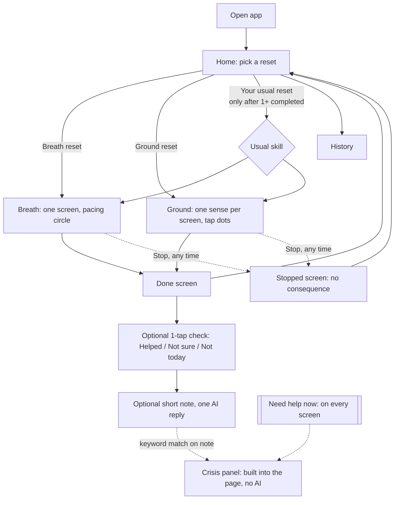
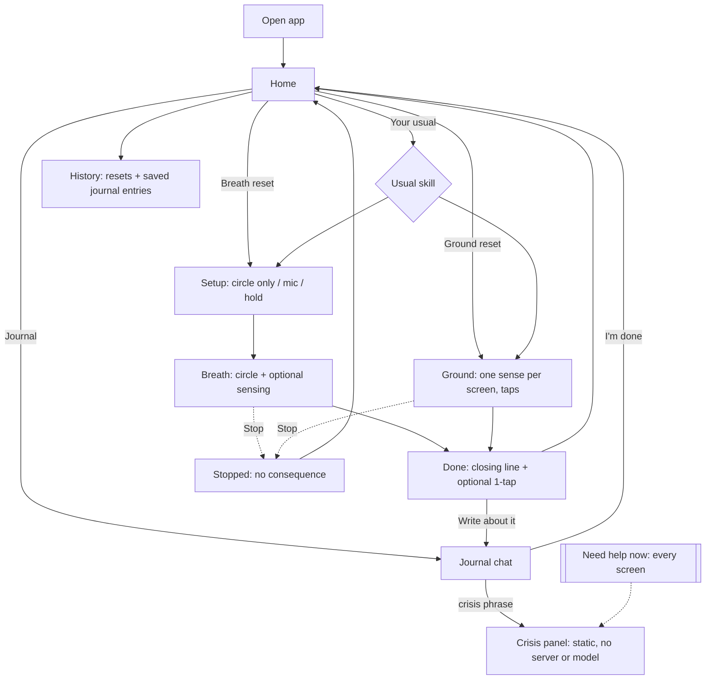

# Reset: Design Notes (Part 3.1)

This is a class prototype. It's not a mental health tool or therapy, nobody monitors it, and I only test it with made-up scenarios.

## 1. The idea

The concept comes from my experience in endurance sports. I have run marathons and ultramarathons, and I also compete in triathlon and Hyrox. In long events, something almost always goes wrong: a hard climb, a rough transition, or a station that takes more out of you than expected. What helps in those moments is a short, intentional reset. You bring your breathing back to a steady rhythm, notice what is around you, and then continue. The application is built around that idea, and it offers two short skills:

- Breath reset: paced breathing (inhale for 4, exhale for 6), similar to how I settle my breathing to find a pace again during a race
- Ground reset: 5-4-3-2-1 grounding, similar to how I focus on my surroundings when a race feels overwhelming, done with taps instead of typing

The athletic background shapes only the framing. It appears in the names, in calm words such as "reset", and in the fictional personas I will use for testing. The steps of each skill stay exactly as defined.

### Why the athletic framing is restrained

My first idea was to give the application an energetic, coach-like tone. After reviewing the findings again, I changed that approach. D6 reports that cheerful phrasing was experienced as condescension, and D3 identifies being asked to perform as part of the emotional cost. Endurance sport is full of splits, personal records, and streaks, and that is exactly the kind of pressure this application should avoid. For this reason:

- there are no scores, streaks, badges, or personal records
- there are no slogans or motivational messages
- stopping early is never described as quitting or failing

What remains from endurance sport is the idea of pacing and of a reset as something brief and normal before returning to the day. I still need to check whether this framing works for someone who is not interested in sports (question 1 in section 10).

## 2. Main flow



The "Need help now" button is in the same spot on every screen, including during an exercise and when the AI isn't working. It opens a panel that's part of the page itself, so it doesn't need the server or the AI.

## 3. Screen sketches

```
HOME                              BREATH RESET (during exercise)
+------------------------------+  +------------------------------+
| Reset          [Need help now]|  |                [Need help now]|
|                              |  |                              |
|  Take a short reset.         |  |            .---.             |
|  Stop whenever you want.     |  |          (       )           |
|                              |  |            '---'             |
|  [ Breath reset   ~1 min  ]  |  |        Breathe in... 3       |
|  [ Ground reset   ~1 min  ]  |  |                              |
|  [ Your usual: Breath     ]  |  |                              |
|                              |  |          [ Stop ]            |
|  History                     |  |                              |
+------------------------------+  +------------------------------+

GROUND RESET (one sense per screen) DONE
+------------------------------+  +------------------------------+
|                [Need help now]|  |                [Need help now]|
|  Notice 4 things you can feel|  |  That's the reset.           |
|                              |  |  <one short AI line>         |
|     ( * ) ( * ) ( ) ( )      |  |                              |
|   tap a dot each time you    |  |  How was it? (optional)      |
|   notice one, no need to     |  |  [Helped][Not sure][Not today]|
|   type what it is            |  |                              |
|                              |  |  [ Back to home ]            |
|   [ Next sense ]   [ Stop ]  |  |                              |
+------------------------------+  +------------------------------+
```

Home is the busiest the app ever gets, with two or three choices and a History link. During an exercise you only see the cue, Stop, and Need help now.

## 4. My decisions and why

| What I decided | Findings | What I give up |
|---|---|---|
| Only breathing and grounding | D3 (the emotional cost showed up mostly on breathing and grounding, and both can be done with almost no input), R1 | No STOP or reframe. The reframe needs thinking and typing, which doesn't fit D3 or 90 seconds. |
| One thing per screen, and grounding goes one sense at a time | D2 | Grounding becomes 5 screens instead of 1 list, so there are more transitions to time. |
| Tapping instead of typing in grounding | D3 | The app doesn't know what the person noticed, so the AI can't respond to it. That's on purpose. |
| Stop is on every exercise screen and takes you to a calm screen ("You stopped. That's fine."). It's saved as "stopped", never as a fail | R3 | Stopped sessions still show in history, but they're worded neutrally. |
| The user picks the skill. "Your usual" is an extra button, not something the app starts on its own | R4, D5 | It's one more tap than auto-starting, but the person stays in control. |
| Need help now is on every screen, built into the page, and works without the AI | R2, D4 | It takes up a bit of space everywhere, even during exercises. |
| The screen gets simpler based on where you are, not on guessing how you feel | D1 | The app never pretends to know how someone feels. |
| Soft colors, the only motion is the breathing circle, short plain sentences | D6 | It looks less "branded". The sports theme stays in the words, not in bright visuals. |
| The AI only writes short lines; the steps are written in my code | D6, assignment section 2 | The app is less chatty, but the AI can't change or make up the skill. |

## 5. D1 without guessing distress

D1 says the screen should show less as distress goes up, but the study doesn't say how an app would know that. I'm not trying to detect it. I thought about three options:

1. Guess from clicks or speed. This came up in our class discussion of the clicking-behavior study. I'm not doing it for now because it could be wrong a lot, it could feel like the app is watching you (the assignment says it can't seem like it's monitoring), and it takes the choice away from the user (R4).
2. Ask with one tap, like "How are you right now?". I'm not doing this either, because asking someone to rate their feelings is an emotional cost (D3).
3. Show less the deeper you go. This is what I chose. Each step into the experience has less on the screen, and the person decides how far to go.

What the app actually knows: which button you tapped, timing, whether you stopped, the optional one-tap answer, and the optional note. What it assumes: if you start an exercise, you want fewer things on screen. How you can change that: hit Stop or go home anytime.

## 6. What the AI does and doesn't do

*Updated in 3.2: the optional note became a full Journal mode. See section 12.*

I'm using Claude through the Anthropic API. The plan is `claude-haiku-5-5`, set in an environment variable so I can change it. Only the backend talks to the AI, never the browser.

What the AI does:
- one short line before an exercise (around 20 words max)
- one short line on the Done screen, which can mention which skill it was, whether it was your usual, or how many times you've done it
- one short reply if you write an optional note after a reset

What my code handles, not the AI:
- the steps of each skill, which are saved in a fixed table and never generated
- the timing of the breathing circle
- the Stop and exit buttons and where they go
- the Need help now panel
- what gets saved

The prompt also has rules, but they're a backup, not the main safety plan:
- don't diagnose, use clinical words, give therapy advice, or suggest new techniques
- no coach hype, exclamation marks, or emojis
- two sentences max
- never say or imply someone is watching or will check in
- don't claim to be a therapist

My code also checks each reply. If it's too long or uses words from a short blocked list ("diagnose", "disorder", "you should try"), it gets swapped for a pre-written line.

If the AI takes more than about 3 seconds or errors out, the app shows a pre-written line like "That's the reset. Take your time." and keeps working. The opening line loads while you're on the home screen, so it never slows down the exercise itself.

This works a lot like the hotel chatbot. There, the hotel info was the fixed context. Here it's the skill steps and your own history, and the AI just words things around that.

## 7. Crisis access

The Need help now button is in the header on every screen. It opens a panel that's part of the page:
- call or text 988 (Suicide & Crisis Lifeline, US)
- text HOME to 741741 (Crisis Text Line)
- call 911 for an emergency
- "This is a class prototype. It can't help in an emergency."

There's no server call, no AI, and no classifier involved, so it should work even with the backend turned off. That's one of the behavior checks I'm planning.

The only place someone can type is the optional note after a reset. Before that text goes to the AI, my backend checks it against a list of crisis-related words and phrases (the frontend has a copy too). If something matches:
- the AI doesn't get called
- a calm, pre-written message shows up and the crisis panel opens
- the person can close the panel and keep using the app, and nothing gets locked
- the message is saved with a crisis flag so I can test it, but it's not sent anywhere

Limits of the keyword list:
- it'll miss indirect wording or typos
- it'll flag some things it shouldn't, especially with sports slang like "this workout is killing me" or "I'm dead after that long run"
- I'm fine with extra false alarms, because a false alarm only opens an info panel
- the app never calls it detection or monitoring

## 8. Timing

I'm measuring from the first exercise instruction to the last planned step. Opening the app and the Done screen are counted separately.

Breath reset:
- first instruction ("Follow the circle. In for 4, out for 6."): 3 s
- 6 breaths, 4 seconds in and 6 seconds out: 60 s
- ending ("Last breath out. That's it."): 3 s
- total: about 66 seconds, and there's no AI call during it, so no waiting on the network

Ground reset (assuming about 2.5 seconds to notice and tap each thing):
- intro: 3 s
- 15 things at 2.5 s each: 37.5 s
- 5 sense screens with about 3 s to read each one: 15 s
- total: about 56 seconds, or about 78 seconds if someone takes 4 seconds per thing, which is still under 90
- people can tap "Next sense" early, and nothing makes them find everything

Opening the app and picking a reset takes about 3 to 5 seconds, counted separately.

No timer ever ends the exercise or kicks someone out. If they take longer, the app just waits.

For 3.2, I want to try a small experiment: build only the breathing circle, record the real timestamps, and compare them to my 66-second estimate.

## 9. What gets saved and how it personalizes

It's one local user with no accounts. Nothing leaves my computer except the requests to the AI.

```
sessions
  id, started_at, ended_at, skill ('breath'|'ground'),
  status ('completed'|'stopped'), steps_completed, duration_s,
  feedback ('helped'|'not_sure'|'not_today'|NULL), was_usual (0/1)

messages
  id, session_id, role ('assistant'|'user'), content,
  source ('model'|'fallback'|'static'), crisis_flag (0/1), created_at

skill_steps          -- fixed script, loaded at setup, the AI never writes here
  skill, step_order, text, duration_s
```

How it personalizes without settings (D5):
- "Your usual" is whichever skill you've finished the most in your last 10 sessions. It only shows up after you've finished at least one.
- If you tapped "Not today" the last two times for a skill, it stops showing as your usual. I'm not sure yet if that's too much.
- The AI's closing line can mention it lightly, like "Your usual breath reset, done."

The History page is a simple list with the date, skill, whether you finished or stopped, and about how long it took. There are no streaks, charts, or scores, and there's a Clear history button that deletes everything.

What I give up: there's no settings page, so you can't, for example, change breathing to 5 rounds. Adding settings would be the kind of setup D5 says to avoid. I might come back to this.

## 10. Questions I still have

1. Does the sports "reset" idea help, or does it turn some people off? I want to test it with a fictional non-sporty person too.
2. Is 66 seconds of breathing right, or should there be a shorter option of about 40 seconds? R1 says around 60 felt comfortable.
3. Should the breathing circle have optional sound or vibration? Speech is optional for this assignment and would mean more browser testing.
4. Is hiding "Your usual" after two "Not today" answers helpful, or does it take control away?
5. How big should the crisis keyword list be, and how do I fairly test what it misses with made-up inputs?
6. Should I save the notes people write, or only keep them for that session? It's a trade-off between privacy and history.
7. Which breathing or grounding apps should I look at for the UI research step? I haven't done that yet.
8. Is one AI reply after the note enough to count as conversational, or do I need a short optional chat?

## 11. Reuse

I'm starting from scratch. I'll use the same stack and patterns from class (Vue, FastAPI, SQLite, a backend route that calls the AI, and saved conversation history like in the RAG activity), but I'm not copying code from A1, A2, or the RAG activity.

## 12. Changes in Part 3.2

After Part 3.1, I met with my instructor and got several suggestions: let the app notice that you're breathing, add a chatbot part with a journaling style and a long, careful system prompt, add modes, let people talk to the app instead of typing, and try something interactive with the vision API, like drawing. I couldn't do all of it well in one week, so I chose two for 3.2 and left the rest for 3.3.

### What I added

**Breath sensing (optional).** Before a Breath reset starts, the person picks how to follow along: just the circle, the microphone, or press and hold. With the microphone, the browser measures how loud the sound is a few times per second. During the 3-second intro it learns the room's background level, and during each exhale it looks for a breath-out sound. When it hears one, the circle shows a soft "with you" note. With press and hold, the person holds the circle while breathing in and lets go while breathing out. The hold option is there for people who don't want to turn on the microphone, or whose microphone doesn't work.

Why this fits the findings:
- It is a choice, and "just the circle" is always there (R4).
- It never turns into a score. The app saves how many breaths it noticed, but it never shows a number like "5 of 6" afterward (D3, and the no-scores rule).
- The microphone sound is only checked in the browser and is never recorded or sent. The screen says so, because the app must not seem like it is monitoring anyone.
- The choice is remembered for next time, so nobody has to set it up again (D5).

Limits: fans, music, or a noisy room can sound like breathing, and quiet breathers or far-away mics may not be heard. That's why it only gives a gentle cue and never decides anything.

**Journal mode.** The Journal is a separate space on the home screen, below the two resets. It is not part of the exercises, so the exercises stay short and simple (D2, R1). The model's role is bigger here than in my 3.1 plan, which only had one reply to a short note. The system prompt is in `backend/app/prompts/journal_system.md` (about 170 lines). It covers what the companion is and isn't, tone rules taken from D6, reply length, reflecting and validating, optional writing prompts, offering the app's two skills, how to use personal context, sports talk, safety, real resources (988, Crisis Text Line, NAMI HelpLine, SAMHSA), and permission to stop.

**Personal context without setup.** Instead of asking people to fill out a profile, the companion gets a short CONTEXT block built from what they already did in the app: how many resets they finished this week and the first lines of their last three journal entries. A checkbox under the Journal ("Let the companion see my past journal entries") turns the second part off. The prompt tells the model to describe these as things the person wrote in the app, never as something it noticed or tracked.

### How safety works in the Journal

The same rules from section 7 apply, with more text to check:
1. Before any model call, the message is checked against the crisis phrase list, both in the browser (so the panel opens right away, even with the server down) and in the backend.
2. On a match, the model is not called, a fixed message is shown, the crisis panel opens, and the message is saved with `crisis_flag = 1`.
3. Crisis-flagged messages are never added to later model context.
4. Every model reply goes through `clean_reply()` in `backend/app/safety.py`. Clinical words, therapist claims, and monitoring language are blocked, exclamation marks and emojis are removed, and replies over 110 words are replaced with a fallback.
5. If the model fails or takes longer than 12 seconds, the person sees "I'm having trouble replying right now. Your words are saved here." Their message is still saved.

### What I left for 3.3

- **Voice input and output.** Many people prefer talking to typing, and the assignment allows speech if I test it and keep a typed alternative. I want to do it carefully, because a voice that sounds like a person talking can make the app feel like therapy, which it must not claim to be.
- **Drawing with vision feedback.** I need to work out how this connects to the research. Drawing could be a low-effort activity, but asking someone to make something the model then comments on could feel like being judged (D3, D6).
- **Live model testing.** I don't have an API key yet, so everything in 3.2 uses mock replies.

### Updated flow


